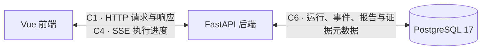
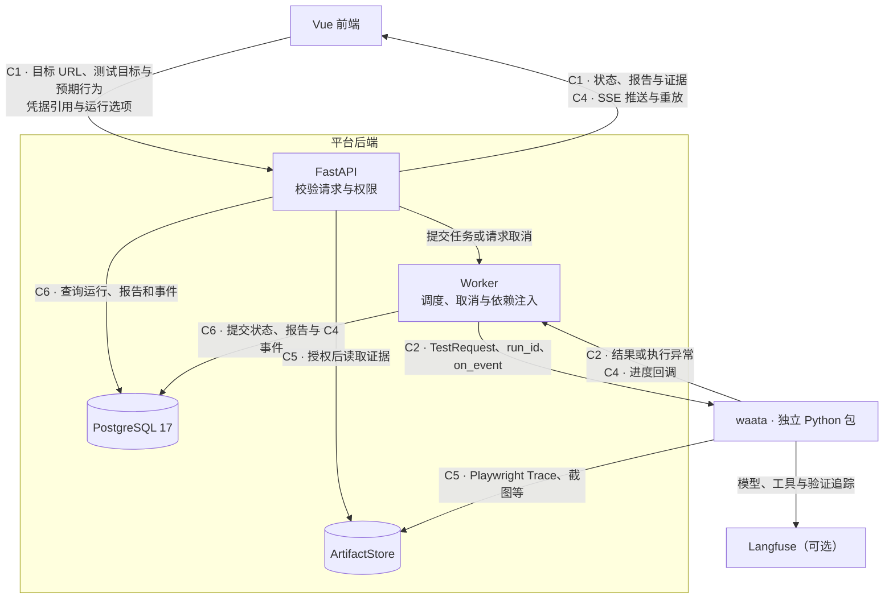
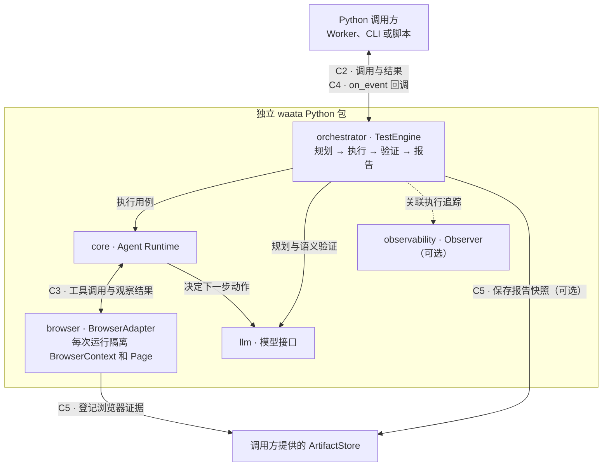

# WAATA 跨模块契约

C1～C6 是 WAATA v0.1 的契约。[4gaBoards 端到端示例](examples/README.md)展示了从提交任务到查看报告时 C1～C5 的数据流。

## 项目结构

## 后端如何调用 WAATA

Worker 将模型、浏览器适配器、证据存储和可选的 Observer 注入 TestEngine，并为 C4 事件编号后持久化。报告通过 `langfuse_trace_id` 关联 Langfuse 追踪。

## WAATA 包内部结构

## 契约索引

| 契约 | 参与模块 | 内容 | 示例 |
| --- | --- | --- | --- |
| [C1 · 测试任务 HTTP API](http/c1-test-run-http-api.md) | Vue ↔ FastAPI | 任务、报告和证据的 HTTP 接口 | [创建请求](http/examples/4gaboards-create-run.json) |
| [C2 · WAATA Python API](waata/c2-waata-python-api.md) | Worker ↔ WAATA | TestEngine、输入输出、错误与取消 | [TestRequest](waata/examples/4gaboards-test-request.json) · [TestResult](waata/examples/4gaboards-test-result.json) |
| [C3 · 浏览器工具](tools/c3-browser-tools.md) | Agent Runtime ↔ BrowserAdapter | 工具输入、结果与执行边界 | [工具调用](tools/examples/4gaboards-tool-calls.json) |
| [C4 · 测试运行事件](events/c4-test-run-events.md) | WAATA → Worker → Vue | 事件信封、终态与 SSE 重放 | [SSE 响应体](events/examples/4gaboards-events.sse) |
| [C5 · 测试证据与产物](artifacts/c5-test-evidence-artifacts.md) | WAATA、存储层、Vue | 证据登记、引用和授权读取 | [证据元数据](artifacts/examples/4gaboards-artifact-views.json) |
| [C6 · 平台持久化](database/c6-platform-persistence.md) | FastAPI、Worker ↔ PostgreSQL | 排队、运行状态、事件、报告和证据元数据的持久化 | [PostgreSQL 17 参考 DDL](database/examples/schema.sql) |

变更公共契约时，由相关方共同评审，并同步更新来源模型、示例和契约测试。详见 [协作规约](../CONTRIBUTING.md)。
