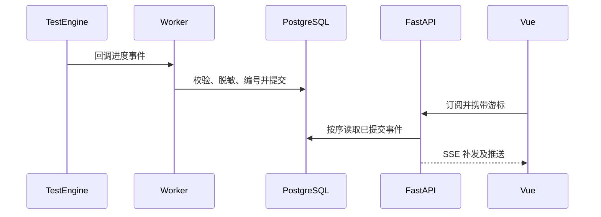

# C4 · 运行事件与 SSE

## 信封与类型

`TestEvent` 包含 `schema_version=1`、`event_id`、`run_id`、`type`、UTC `timestamp`、可空的 `case_id`、可空的 `step_id` 和对象类型 `payload`。平台提交时增加同一 Run 内从 1 连续递增的 `sequence`，上限为 JavaScript 安全整数。客户端按 Run 与 `sequence` 排序、去重。数据库以 `(run_id, event_id)` 识别内容一致的重试。[回调模型](../../packages/waata/src/waata/core/events.py) · [C6 事务](../database/c6-platform-persistence.md)

| `type` | 来源及范围 | `payload` |
| --- | --- | --- |
| `run.started` | 平台，Run | `{}` |
| `plan.created` | 引擎，Run | `total_cases`，非负整数 |
| `case.started` | 引擎，Case | `name` |
| `agent.step.started` | 引擎，Step | 可空的 `summary` |
| `tool.called` | 引擎，Step | `tool_call_id`、`tool` |
| `tool.completed` | 引擎，Step | `tool_call_id`、`tool`、`success`、`duration_ms`、可空 `error_code`、`evidence_ids` |
| `case.verified` | 引擎，Case | C2 的用例 `verdict` |
| `report.generated` | 平台，Run | `artifact_id=null`，表示数据库中的报告已可查询 |
| `run.completed` | 平台，Run | `status=succeeded`、C2 的总体 `verdict`、`error=null` |
| `run.failed` | 平台，Run | `status=errored`、`verdict=null`、`error` |
| `run.cancelled` | 平台，Run | `status=cancelled`、`verdict=null`、`error=null` |

Case 事件带 `case_id`，Step 事件另带 `step_id`。工具事件以 `tool_call_id` 配对，耗时以非负整数毫秒记录。取消或故障可能留下已开始而未完成的调用。事件公布已登记的证据 ID 和脱敏摘要。

每个进入终态的 Run 提交一条终态事件。队列取消可以直接进入 `run.cancelled`。如存在报告，`report.generated` 紧邻终态事件之前，均与终态及报告在同一事务中提交。业务断言失败可表现为 `run.completed` 及 `verdict=failed`。技术故障与取消由各自的事件表达，客户端可查运行详情校准状态。[判定契约](../waata/c2-waata-python-api.md) · [持久化](../database/c6-platform-persistence.md)

## 重放与断线

`GET /api/v1/test-runs/{run_id}/events` 先按 C1 验证权限，再读取游标。非空 `Last-Event-ID` 优先，其次为 `after`，默认从 0 开始。合法游标是从 0 到当前已提交最大序号的十进制整数，非法时在建流前返回 `400 INVALID_EVENT_CURSOR`。终态已读尽时返回 `204`。

每帧以空行结尾，`id:` 使用十进制 `sequence`，`event:` 使用事件类型，`data:` 包含完整 JSON 信封。服务端按序发送 `sequence > cursor` 的已提交事件，空闲时发送 `: keep-alive` 注释，终态发送后结束连接。存储故障引起的流中断可从上一序号重连。Vue 收到终态后关闭连接并更新详情。[HTTP 契约](../http/c1-test-run-http-api.md) · [SSE 示例](examples/4gaboards-events.sse)

`WAATA_SSE_POLL_SECONDS` 默认 0.25 秒，`WAATA_SSE_KEEPALIVE_SECONDS` 默认 15 秒。[SSE 实现](../../apps/api/src/waata_api/services/run_events.py) · [平台验收](../../docs/04-acceptance.md#ac-05-平台端到端)

运行详情默认显示运行及用例的进展、截图和工具失败。同一用例内相同工具与错误码的失败显示累计次数。通过「查看全部事件」可按序号查阅每条事件和原始数据。
