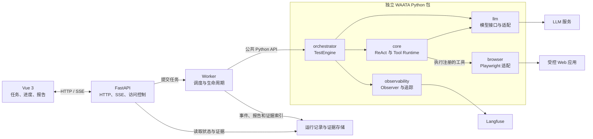

# 03 系统架构

状态为设计基线。公共接口的签名和数据格式由团队在[契约目录](../contracts/README.md)共同评审。

## 系统边界

图中箭头表示运行时调用或数据流。静态依赖从应用指向 WAATA 公共 API，WAATA 可独立于 Vue、FastAPI 和平台数据库使用。通用 `core` 通过工具接口运行注册的工具。Playwright 工具由浏览器适配层提供，通过接口注册到运行时。

## 应用层

| 路径 | 职责 |
| --- | --- |
| `apps/web/src/api` | HTTP 客户端和前端 API 调用 |
| `apps/web/src/features/test-runs` | 任务创建、运行与报告视图，以及对应组件和 Pinia 状态 |
| `apps/web/src/components`、`apps/web/src/router` | 通用组件与路由 |
| `apps/api/src/waata_api/api/v1`、`schemas` | HTTP 路由、请求和响应 |
| `apps/api/src/waata_api/services`、`workers` | 任务协调和 WAATA 调用 |
| `apps/api/src/waata_api/repositories`、`infrastructure` | 运行记录、证据存储、队列和数据库适配 |

创建任务后，API 分配 Run ID 并返回可查询的任务记录。Worker 执行长任务，后端记录状态和证据引用，Vue 用查询接口或 SSE 显示进度与报告。部署所需的队列持久性、故障恢复和取消语义见 [Q-003](05-open-questions.md#q-003-队列持久化与恢复)。

## 核心包

| 模块 | 职责 |
| --- | --- |
| `waata.orchestrator` | 对外暴露 TestEngine，协调 Planner、Runner、Verifier 与 Reporter |
| `waata.core` | 提供 ReAct 循环、上下文、事件与工具注册和执行 |
| `waata.llm` | 提供统一模型接口与 OpenAI 兼容适配，支持 DeepSeek 等兼容服务 |
| `waata.browser` | 抽象浏览器适配、页面观察与测试工具，封装 Playwright 会话和 Trace |
| `waata.observability` | 定义 Observer 接口，将模型调用、工具动作与验证结果串到同一个 Run。Langfuse 是可选实现 |

Planner 把目标和预期转成用例。Runner 在预算内观察页面、选择并调用注册的功能操作、记录实际结果。Verifier 优先执行确定性断言，按需使用模型判断语义，并把结论关联到证据。Reporter 汇总结构化结果与证据引用。引擎的拟议调用方式见[示例说明](../examples/README.md)。

## 资源与隔离

- 调用方创建并持有 Playwright Browser、模型客户端与观测客户端。BrowserAdapter 为每个 Run 建立独立的 BrowserContext 与 Page，负责会话级追踪及退出时清理。共享浏览器进程时仍保持会话隔离。
- 每次 Run 使用独立的 Agent 上下文、验证结果和证据索引。规划、执行、验证可共享模型接口并保留各自的上下文和预算。用例间的测试数据与会话复用策略见 [Q-004](05-open-questions.md#q-004-运行和用例隔离)。
- 浏览器适配层校验授权目标及动作范围。追踪记录保留 Run、用例和步骤关联，以及足以解释结果的观察、动作和短摘要。
- 核心包返回结构化报告与证据引用。后端持久化证据并授权前端访问。Langfuse 侧保留可关联的 Trace ID。
