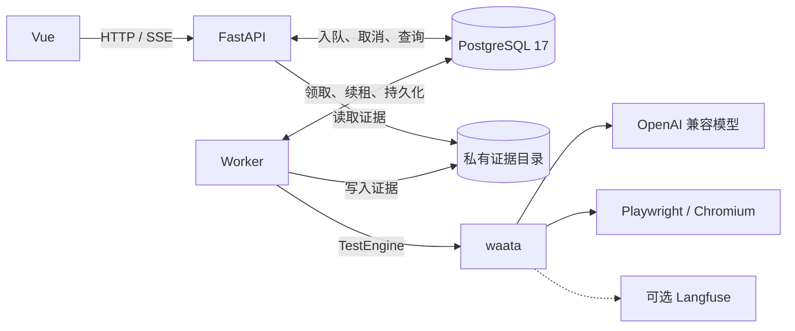
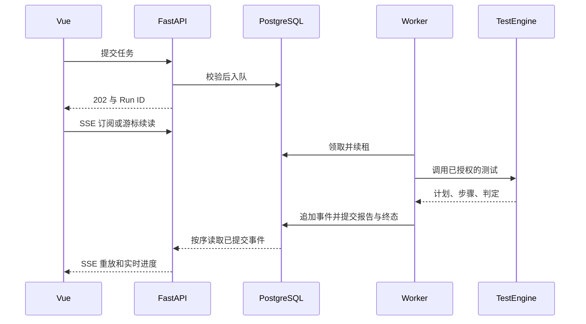

# 03 系统架构

Vue 的场景库使用浏览器本地存储。运行、进度、报告和证据经 FastAPI 获取。API 与 Worker 使用同一 PostgreSQL 和证据目录。Worker 将平台的存储与配置通过公共接口注入 `waata`。核心包不依赖 Web 框架、任务队列或平台数据库。[独立 Python 包决策](adr/0001-package-boundary.md) · [C1～C6](../contracts/README.md)

## 一次运行

Worker 在领取时写入 `running`、租约和首条 `run.started`。心跳读取取消标记，受租约保护的写入必须持有执行令牌。失去租约的运行以 `WORKER_ERROR` 收尾。运行正常完成时，判定可以为 `passed`、`failed`、`blocked` 或 `inconclusive`。`errored` 和 `cancelled` 的总体判定均为空。[C1](../contracts/http/c1-test-run-http-api.md) · [C4](../contracts/events/c4-test-run-events.md) · [C6](../contracts/database/c6-platform-persistence.md)

## 核心包

| 模块 | 职责 |
| --- | --- |
| `waata.orchestrator` | 规划用例、编排执行、核对检查点并整理报告 |
| `waata.core` | 通用 Agent 循环、历史、事件、工具注册与执行 |
| `waata.llm` | 模型接口与 OpenAI 兼容适配 |
| `waata.browser` | 浏览器会话、动作策略、页面观察、确定性检查及证据 |
| `waata.observability` | Observer 接口及可选的 Langfuse 追踪 |

Worker 为每个 Run 启动 Chromium，适配器为各用例创建独立的 `BrowserContext`。模型负责规划和选择动作，运行时核对工具参数、授权和预算。确定性检查基于页面与同一用例证据。站点账号和业务数据由测试环境按场景准备与重置。[C2](../contracts/waata/c2-waata-python-api.md) · [C3](../contracts/tools/c3-browser-tools.md) · [C5](../contracts/artifacts/c5-test-evidence-artifacts.md)
